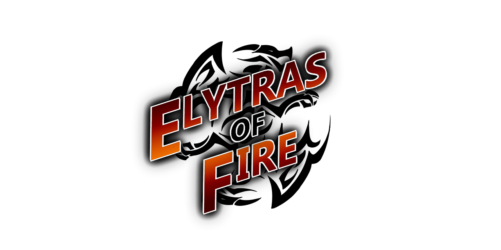

# Elytras Of Fire

## About 
Elytras of Fire is a Minecraft plugin designed for [Wings Of Fire: The New World](https://woftnw.org/) which is a Minecraft server about Wings of Fire.

## How to install
1. Make sure your server is Paper or a Paper fork.
2. Clone the repository
3. Build the repository using `./gradlew build`
4. Move the built file to your `/plugins` folder in the server's directory.

## Features
- [ ] Tribes
  - [ ] IceWings
  - [ ] MudWings
  - [ ] NightWings
  - [ ] RainWings
  - [ ] SandWings
  - [ ] SeaWings
  - [ ] SkyWings
- [ ] Abilities
  - [ ] Frost Breath
  - [ ] Flame Breath
  - [ ] Venom Shot
  - [ ] Tidal Wave
  - [ ] Serrated Strike
  - [ ] Terrashock
  - [ ] Shade Shackle
  - [ ] Overgrowth
  - [ ] Desert Storm
  - [ ] Ocean's Blessing
  - [ ] Sky Surge
  - [ ] Icicle Incision
  - [ ] Mud Swipe
  - [ ] Premonition
  - [ ] Soul Sap
  - [ ] Toxin Slash
  - [ ] Tail Flail
  - [ ] Spark Punch
- [ ] Passives
  - [ ] Cryoenergy
  - [ ] Rejuvenation
  - [ ] Sibling Bond
  - [ ] Gloom Cloak
  - [ ] Camouflage
  - [ ] Dune Surfer
  - [ ] Torrent
  - [ ] True Blessing
  - [ ] Skyborn
- [x] Commands
